<p align="center">
  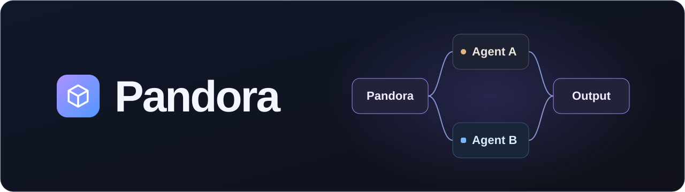
</p>

# Pandora

**Run coding agents in VS Code with the engine and models you choose.**

Pandora brings agent chats, tasks, workflows, project notes and documentation into one place. Work with one agent or add a team, follow their progress, inspect changes and keep shared context with your project.

Codex, Claude Code or Ollama alone is enough. Use agent tools you're already signed in to, or run an installed local model through Ollama. Pandora does not require separate model API keys for these setups. Your providers' usage limits and billing still apply.

> **In development · Not publicly available yet.** This repository previews Pandora. The setup instructions below are for testers who already have a build.

[Chat](#team-chat) · [Agents](#project-agents) · [Tasks](#tasks-and-code-review) · [Workflows](#workflows) · [Docs](#project-documentation) · [Knowledge](#project-knowledge) · [Usage](#usage-and-controls) · [Settings](#settings-and-updates) · [Tester setup](#tester-setup) · [Feedback](#feedback)

[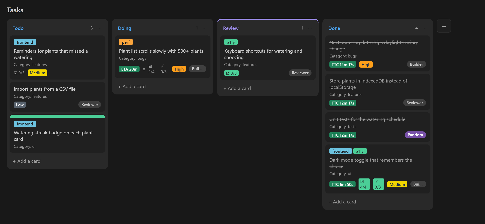](docs/images/tasks.png)

## Team chat

Messages go directly to the agent you select, which handles the work itself. New projects start with **Pandora**. Select another project agent, mention it by name or use `@all` to address the active team. Coordination between agents is available when you run a workflow.

```text
Add a dark mode toggle, then run the tests.
```

[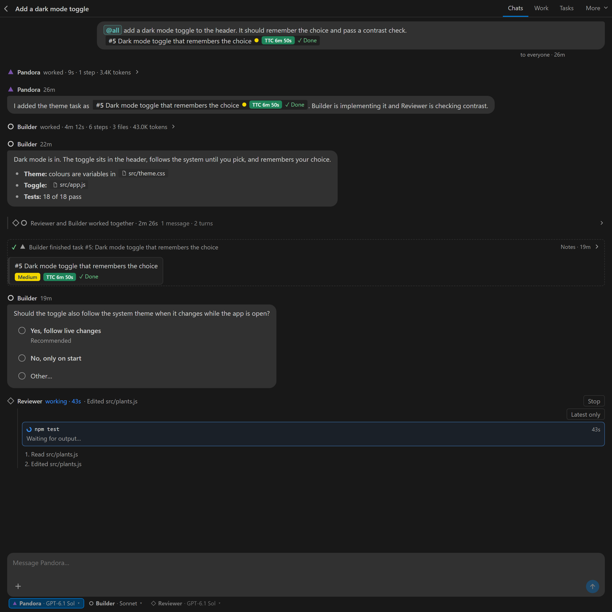](docs/images/chat.png)

<details>
<summary><strong>Chat tools</strong></summary>

- Keep separate conversations with their own agent sessions. Rename, archive or delete chats as needed.
- Type `@@` for workspace file autocomplete. Use `@` for project agents, task groups and enabled plugin shortcuts.
- Open file links from replies and attach files, images or pasted text. Agents can send screenshots back.
- Answer questions with clickable choices, edit or delete messages you've sent, and add follow-ups during active work.
- Choose models and effort levels, and set each agent's access for the current chat.
- Expand a turn to see steps, commands, output, duration, exit status and changed-file diffs.
- Open the sub-agent menu to see each helper's task, state, activity and result.
- Inspect logs, retry failed turns and undo recorded file changes when their snapshots can be verified.
- Collapse long exchanges while keeping questions and results visible.

[View an expanded turn](docs/images/turn.png) · [View the chat list](docs/images/chats.png)

</details>

## Project agents

Open **Work** to manage the agents in this project. **+** adds an agent with its own name, icon, engine and model. Several agents can use the same engine while keeping separate identities, chats, settings and task assignments.

Pandora stays in every project: its name is fixed and it cannot be retired. Its **Edit** control provides one model dropdown with Codex, Claude and installed Ollama choices. Custom agents have full editing controls and can be retired or restored. Retirement preserves their history and unfinished assignments.

[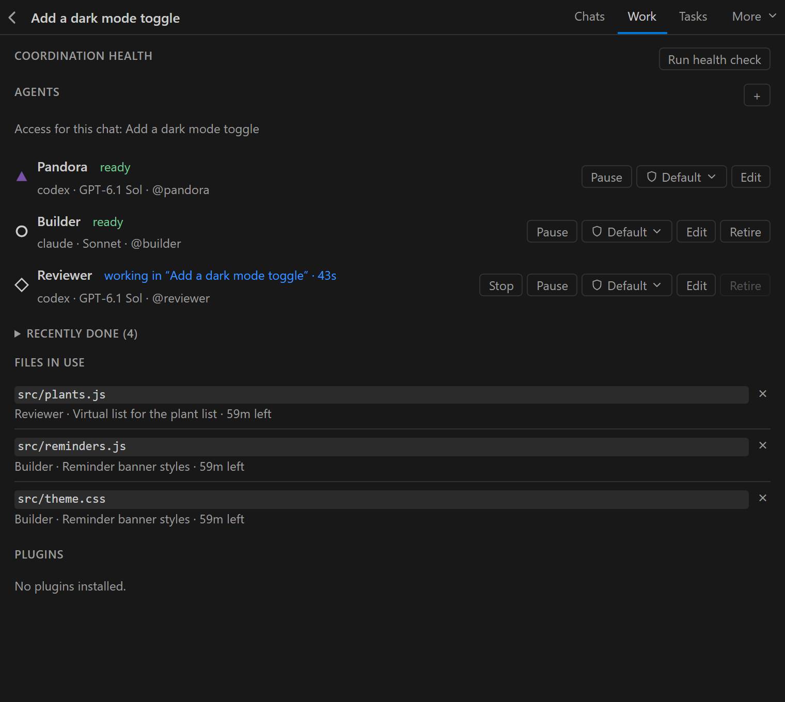](docs/images/work.png)

<details>
<summary><strong>Agent controls</strong></summary>

- Pause new turns, resume queued work or stop an agent.
- Stop cancels current and queued work and clears saved sessions. A manually paused agent stays paused.
- Set per-chat access from each agent's access dropdown. A change during a turn applies from the next turn.
- Inspect claimed files, coordination health and plugin status.
- Use one supported engine throughout the project, including new default workflows.

</details>

### Local models with Ollama

Choose **Ollama** during setup or when adding an agent. Start your Ollama server and install a model that supports tool use first; Pandora lists installed models and checks their capabilities. Refresh the model list after adding or removing a model. The server address is configurable in Settings.

Ollama agents use Pandora's native file and shell tools, shared messages, tasks, knowledge, approved plugin tools and workflow handoffs. They do not require the Claude or Codex CLI. File access follows the chat's permissions and file claims.

Execution receipts show observed tool outcomes. Saved checked steps track supported instructions, help reject wrong targets and premature completion, and preserve pending work across sessions. These checks do not verify every natural-language requirement or arbitrary shell effect. Small local models can still omit work, get stuck or report success after failures; inspect the resulting state and checks before relying on completion.

### Background jobs

For a long test run, build or benchmark, an agent can propose the exact command, folder and shell. Choose **Run** or **Dismiss** in chat or **Work**. Only you start the job. It runs independently of the agent and VS Code window, and completion notifies the proposing agent in the same chat so it can continue.

Work shows elapsed time, exit status, output, logs and running processes when available. **Stop** ends a running job. **Close** removes a finished, failed or stopped job from Work and its linked chat controls, without adding a history section.

Eligible command rows also offer **Run in background** or **Rerun in background**. A live command restarts from the beginning after stopping the agent's current and queued work; partial effects remain. Review the confirmation before restarting a command.

## Tasks and code review

Open **Tasks** beside **Chats** and **Work** for the full task board. Give work a brief, an owner, a checklist, dependencies and acceptance criteria. Assignment alone does not start an agent. **Start** begins the timer and sends an assigned agent its brief.

Expanded cards show a live clock. TTC is calculated from recorded start and finish times, down to the second, and cannot be edited. ETA stays editable. Moving a task, handing it off or reloading keeps its timer running.

Started tasks can complete only after their checklist is finished and every acceptance criterion has passing evidence. Review changed files in VS Code, leave line comments for the agent and open a GitHub pull request from the task. Merging stays with you.

[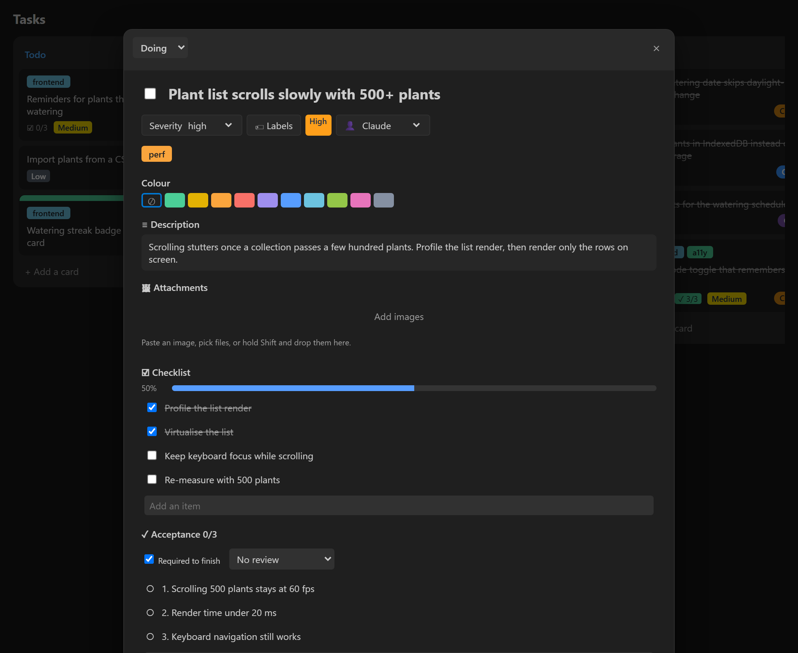](docs/images/task.png)

<details>
<summary><strong>Task details and review tools</strong></summary>

- Start with **Todo**, **Doing** and **Done**, or add columns such as **Review**. Reorder and recolour the board.
- Add owners, categories, tags, severity, images, checklists and dependencies.
- Edit subtask titles and descriptions, with saved changes reflected on the board.
- Create a task without starting it using `/task write tests for the parser`, or use `/task @pandora write tests for the parser` to hand it to an agent.
- Use mentions such as `@Todo` or `@bugs` to reach agents working on a group of tasks.
- Give a task its own Git branch, or use an optional worktree and port.
- Include the task's criteria and checks when opening a pull request. Follow its status from the card.
- Archive finished tasks so agents can look up the work later.

</details>

## Workflows

Open **More → Flows** to see workflows and recent runs, then open the editor to change a workflow. Connect steps for planning, implementation, review and testing. Choose a project agent and role for each step; branches can run in parallel, join together and pause for your input.

New default workflows use the project's Pandora agent, so you can run them with one supported engine. Assign different project agents when you want separate roles or models.

[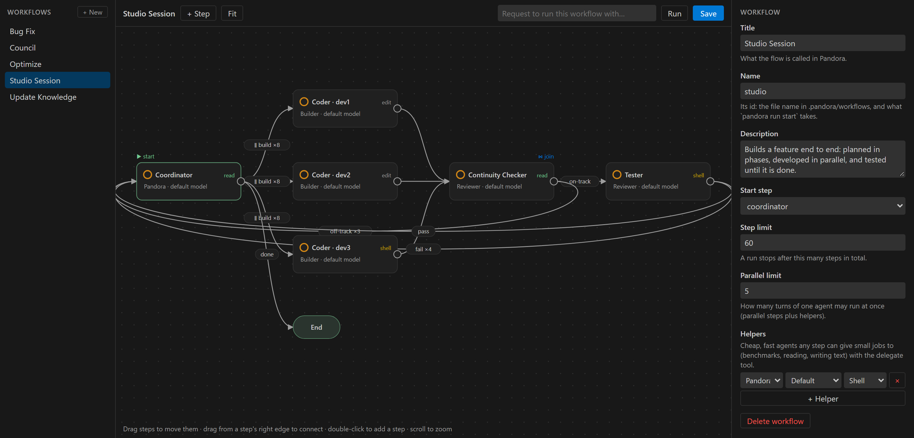](docs/images/editor.png)

Five workflows are included:

| Workflow | What it does |
| --- | --- |
| **Studio Session** | Plans a feature, splits implementation into parallel work, checks that the changes fit together and runs tests. |
| **Bug Fix** | Reproduces a problem, fixes the cause and checks the result. |
| **Optimize** | Measures a baseline, makes changes and measures again. |
| **Council** | Uses discussion and review roles to develop a plan and check decisions with you. |
| **Update Knowledge** | Creates or refreshes the project's shared notes. |

<details>
<summary><strong>Workflow editor and controls</strong></summary>

- Drag steps into place and connect their outcomes. A **Join** step waits for parallel branches.
- Set the project agent, role, model, effort level and permissions for each step.
- Delegate a focused job to a helper.
- Limit steps, loops and concurrent turns, with optional token budgets.
- Start a workflow from the editor or chat: `/run studio add OAuth login`.

[View workflows and recent runs](docs/images/flows.png)

</details>

## Project documentation

Open **More → Docs** to browse project guides and references. Search or navigate nested pages, follow source links, use the page outline and copy syntax-highlighted code.

When you ask an agent to add or maintain documentation, it proposes a draft. Review the changes and accept that exact revision to publish it. Published pages remain available while drafts change.

[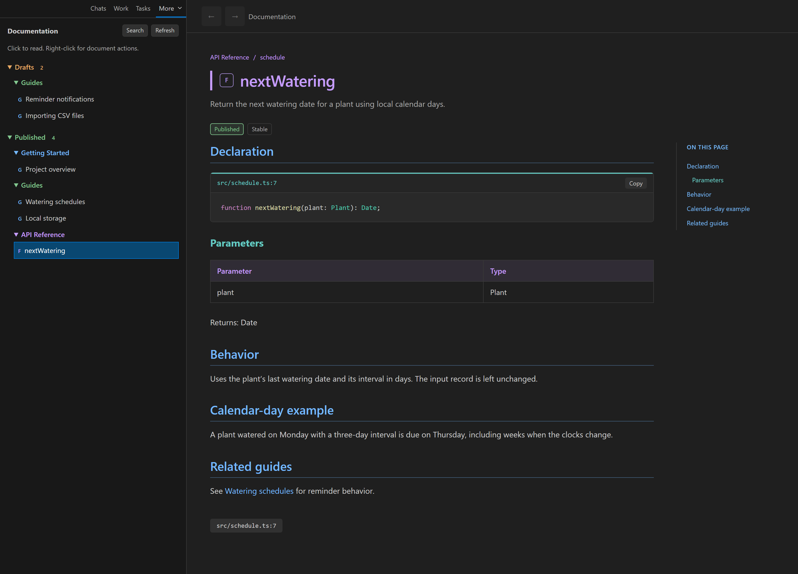](docs/images/docs.png)

<details>
<summary><strong>Documentation tools</strong></summary>

- See pending drafts and their count as they arrive.
- Edit drafts, check source references and links, inspect history, and archive or restore pages.
- Keep draft review separate from the published version.
- Open documentation with `/docs`, or request work with `/docs @pandora document the storage module`.
- Keep human-facing documentation separate from the agents' project knowledge.

</details>

## Project knowledge

Pandora keeps shared decisions, plans and findings in `.pandora/knowledge`. Agents can search what has already been agreed, read the relevant context and update existing notes as the project changes.

Open **More → Knowledge** for a searchable, grouped overview. Select a note to see its direct connections or read it in the sidebar. The notes are Markdown files you can edit and commit with your code.

[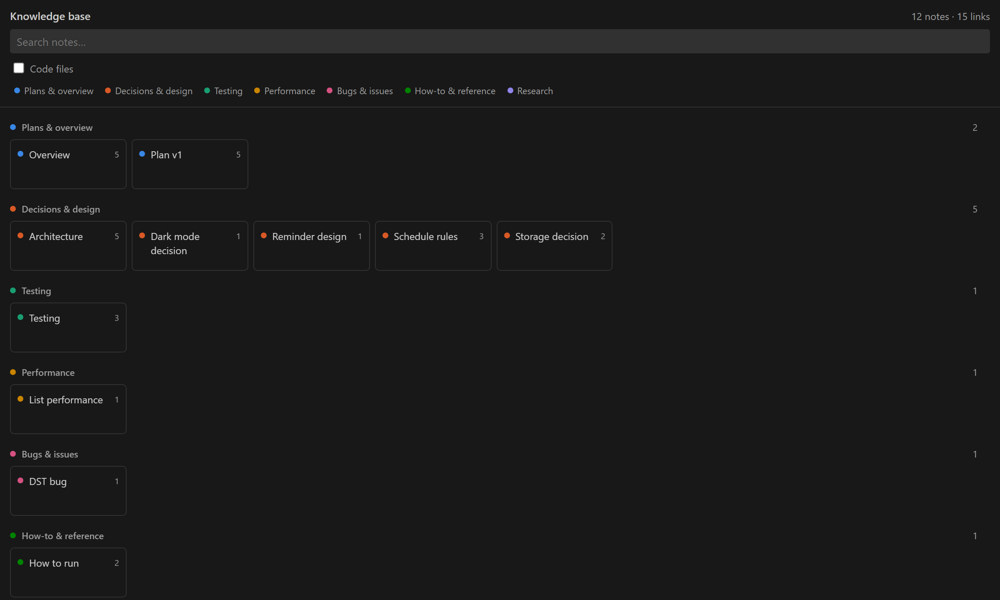](docs/images/graph.png)

<details>
<summary><strong>Working with project notes</strong></summary>

- Keep decisions, plans, findings and how-tos together across conversations.
- Give agents a compact index and tools to find, read and update existing notes.
- Search notes, filter their types and inspect referenced source files.
- Follow direct connections from a selected note, with navigation and scroll preserved.
- Commit the notes so they stay with the project.

</details>

## Usage and controls

Open **More → Stats** to compare time and token use across agents, roles, models and effort levels. Inspect individual runs, slow commands and failed work.

Plugin statistics show calls, measured duration, outcomes and linked-turn token totals by plugin, action and agent. Manual and polling activity is identified separately.

[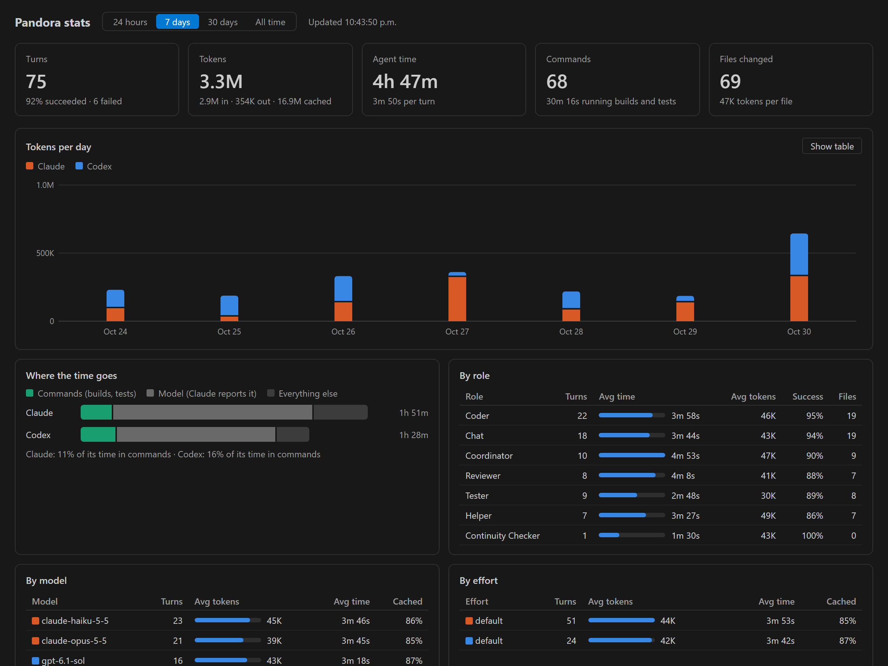](docs/images/stats.png)

<details>
<summary><strong>Usage tracking and budgets</strong></summary>

- Track turns, fresh and cached input, output tokens and elapsed time.
- Compare success rates and average usage by agent, role, model and effort level.
- Separate command time, model time and other work.
- Set optional token budgets for tasks and workflows.

Missing usage is shown as **unknown**. An active turn can exceed its token budget before further work pauses, so budgets are not hard spending caps. Token totals describe usage, not a dollar invoice.

</details>

<details>
<summary><strong>Coordination, permissions and recovery</strong></summary>

Pandora runs agent CLIs or connects to Ollama with shared messages, tasks, file claims and notes. Claims and edit guards help agents avoid conflicting changes; build locks prevent overlapping builds in the same build tree.

- **Permissions:** choose access per chat. Codex uses its configured sandbox; Claude uses a configured tool allowlist. Ollama's native tools enforce the selected access; Shell access is not an operating-system sandbox.
- **Run controls:** pause, resume or stop agents. Loop guards pause repeated exchanges, and timeouts limit stalled work.
- **Health checks:** inspect hooks, commands, the runner, waiting messages and locks on demand. Repairs run only when you choose them.
- **Plugins:** review tools and access before enabling a plugin. Changed packages need fresh approval; licence acceptance stays with the user.
- **Recovery:** automatic daily backups, export and restore keep the board recoverable.
- **Project files:** `.pandora/` holds shared configuration, notes and documentation. Chats, tasks and runtime state are stored separately from source files.

</details>

## Settings and updates

Open **Pandora Settings** from the panel title bar. Search settings, choose User, Workspace or Folder scope, inspect inherited values and overrides, and reset individual settings.

[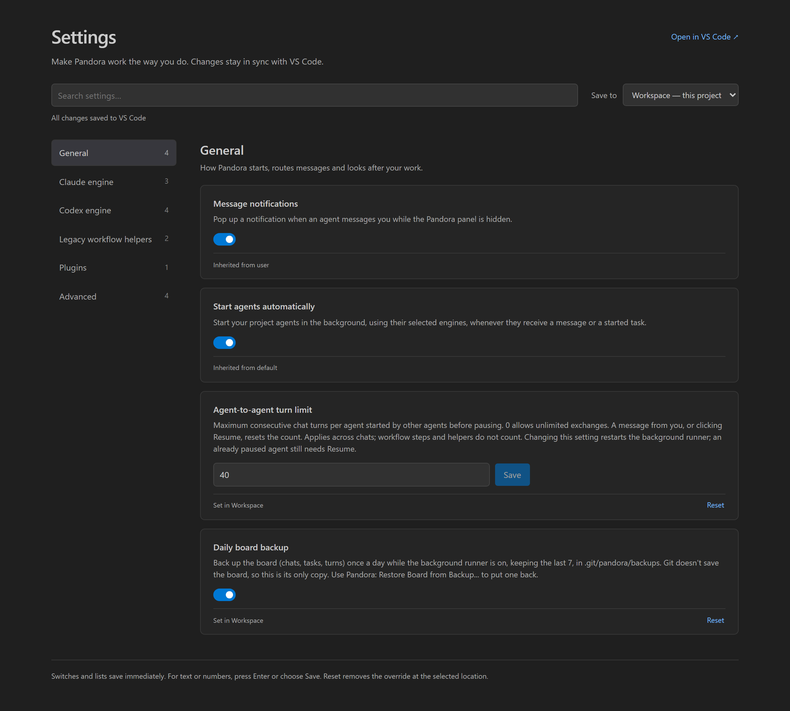](docs/images/settings.png)

**What's New** opens once for each installed version and lists additions, changes and fixes. Reopen it at any time with **Pandora: What’s New** in the Command Palette.

[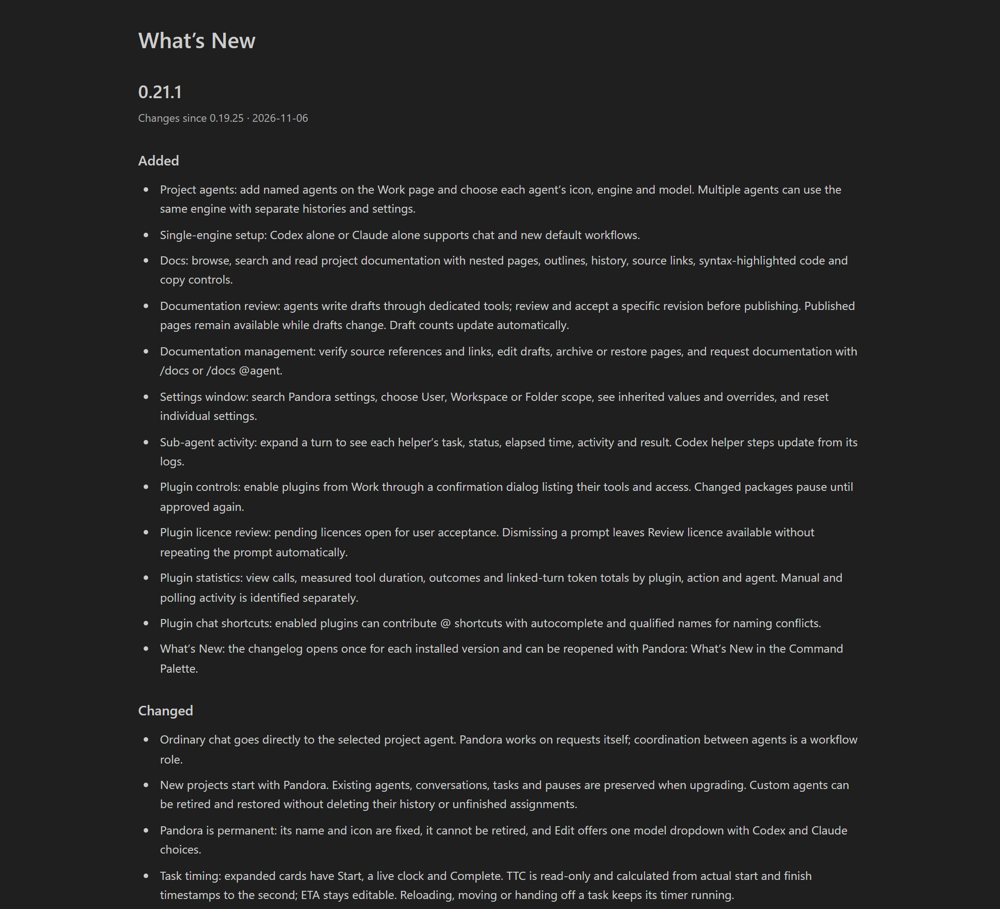](docs/images/changelog.png)

## Tester setup

You'll need a test build supplied to you; Pandora is not publicly available yet.

**Currently supported engines:** Codex, Claude Code and Ollama. You only need one.

**Requirements:** VS Code, Node.js **22.13+**, Git, and either a supported agent CLI installed and signed in or a running Ollama server with an installed tool-capable model. Install the GitHub CLI (`gh`) if you want to open pull requests from tasks.

1. **Unzip your test build.** Use the package provided to you for testing.
2. **Install the extension.** Run `install.cmd` on Windows or `sh install.sh` on macOS/Linux, then reload VS Code.
3. **Set up your project.** Open Pandora from the activity bar, choose **Set up workspace** and select the engine you use.
4. **Complete the selected engine's setup.** If you choose Codex, apply the configuration snippet if shown, start a Codex chat once and approve Pandora's hooks when prompted. Claude-only setup does not require Codex. For Ollama, choose an installed model; no Claude or Codex sign-in is needed.

A first message can be as simple as:

```text
Explain how this project is organised.
```

When you're ready to try a workflow, use `/run studio <your feature>`.

## Feedback

Found a bug or something confusing? [Open an issue](https://github.com/pandora-software/pandora-ai-utility/issues) with what you tried, what you expected and what happened. Include your Pandora and VS Code versions.

Testers can also type `/report` in a Pandora chat. You choose what to include, then a debug report opens for you to read and edit. Reports are filtered to remove paths, email addresses, usernames and keys; chat text is included only if you select it. **Open Issue** submits the report using your own GitHub sign-in.

Issues in this repository are public, so review the report before posting.

---

<p align="center">
  <br>
  <strong>Pandora Software</strong><br>
  <sub>© 2026 Pandora Software · <a href="LICENSE">All rights reserved</a></sub>
</p>
