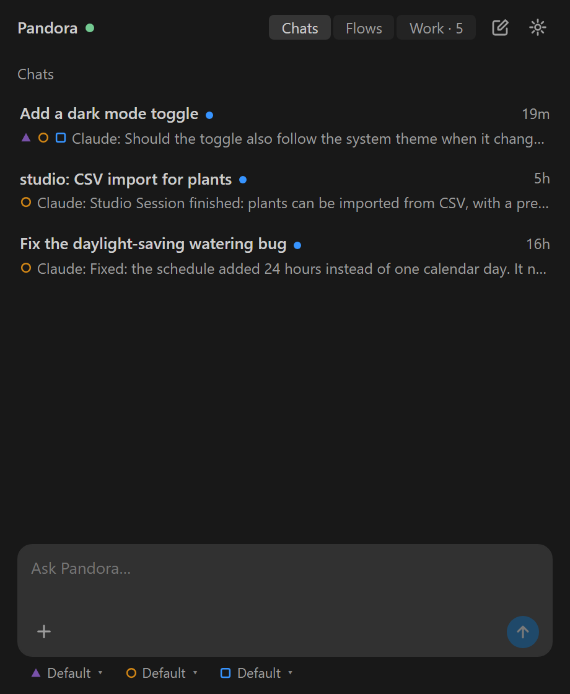
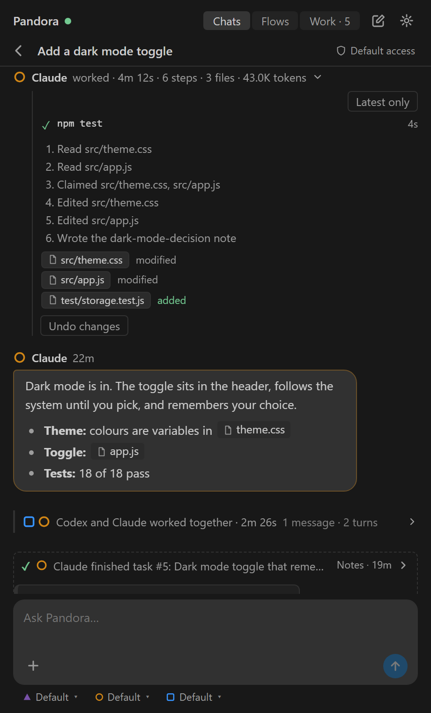
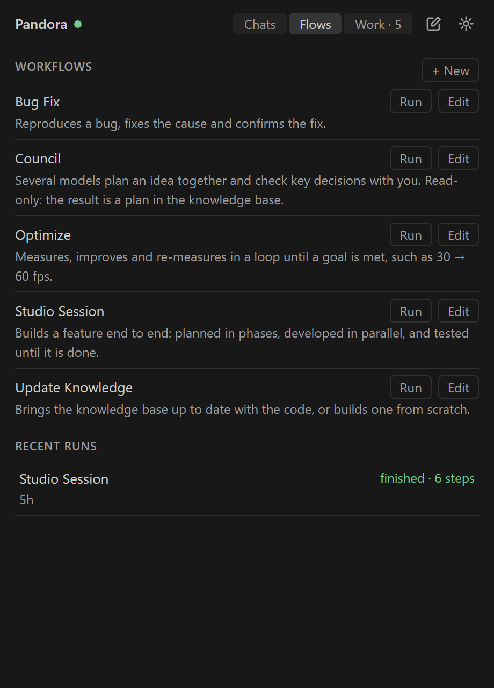

# Pandora

**A VS Code extension that lets AI agents work as a team in your repo, using the subscriptions and models you already have.**

Talk to Claude Code and Codex from one panel. They share your chats, claim files before they edit so they never overwrite each other, keep a shared knowledge base, track work on a task board, and can run as a whole team: one plans, several build in parallel, another tests.

No API keys and no extra bill. Pandora runs the Claude Code and Codex you're already signed in to.

  

- [Chat with your agents](#chat-with-your-agents)
- [See every step, undo any turn](#see-every-step-undo-any-turn)
- [No collisions](#no-collisions)
- [Task board](#task-board)
- [Branches, review and pull requests](#branches-review-and-pull-requests)
- [Team workflows](#team-workflows)
- [Shared knowledge base](#shared-knowledge-base)
- [Stats and budgets](#stats-and-budgets)
- [Safety and control](#safety-and-control)
- [Install](#install)
- [Report a problem](#report-a-problem)

## Chat with your agents

- **One chat, every agent.** Write `@claude`, `@codex` or `@all`. A message with no name goes to **Pandora**, a small coordinator that hands the work to the right agent.
- **Many chats.** Each chat keeps its own agent sessions, so context never leaks between them. Rename, archive or delete them.
- **Point at files.** `@src/app.js` autocompletes from your workspace. File names in replies become buttons that open the file.
- **Images.** Paste a screenshot, drop a file or click **+**. Agents can take screenshots of VS Code and attach them to replies.
- **Questions you click.** When an agent needs a decision, it asks with buttons, so you can answer in one click.
- **Edit and delete.** Fix a message after sending it, right where it is in the chat, and the agent gets the corrected text.
- **Messages arrive mid-turn.** A follow-up reaches an agent that's already working, without waiting for it to finish.
- **Pick models per chat.** The chips under the message box set each agent's model and effort. Codex's list comes from your Codex install.
- **Permissions per chat.** Read only, Edit, or Shell (edit and run commands), for each agent.

 

## See every step, undo any turn

- **Live steps.** While an agent works, you see what it's reading and editing, with a **Stop** button.
- **Build and test cards.** Each command shows live: how long it's been running and what's running under it. When it finishes you get ✓ or ✗, the time and exit code, and the end of its output.
- **Diffs.** Every changed file opens as a before/after diff.
- **Undo.** One click puts back everything a turn changed. It warns you if a file changed again afterwards.
- **Retry and logs.** A failed turn shows why, with **Retry** and **Log**.
- **Quiet teamwork.** Long back-and-forths between agents fold into one line, such as "Codex and Claude worked together · 2m 26s". Questions for you and final results are never folded.

 

## No collisions

- **File claims.** An agent claims a file before editing it. Another agent is blocked from it until it's released, so no one overwrites anyone's work.
- **Work tab.** See who's ready or working, pause or stop an agent, and see which files are in use and why.
- **Health check.** **Run health check** looks at hooks, commands, the background runner, waiting mail and locks. It only reads; repairs run when you choose them.
- **Own worktree per task (optional).** A task can get its own Git worktree and port, so agents can work on several tasks side by side.

 

## Task board

- **Lists.** Todo, Doing and Done are built in. Add your own (like Review), and recolour or reorder them.
- **Cards.** Each card has an owner, a category, coloured tags, a severity, a checklist, images and dependencies.
- **Start when you say.** A new task waits in Todo even when it's assigned. **Start** sends the brief to its owner and moves the card to Doing.
- **Proof of done.** Give a task acceptance criteria. An agent can only finish it after recording a passing check for each one.
- **From chat.** `/task @codex write tests for the parser` adds a task. `@Todo` or `@bugs` messages everyone working on those tasks.
- **Archive.** Clear finished work off the board and still let agents look it up later.

  

## Branches, review and pull requests

- **A branch per task.** Each task can get its own branch, and the brief tells the agent to commit there.
- **Review in VS Code.** **Review changes** opens each changed file as a diff. Comment on a line, and the comment goes straight to the agent that owns the task.
- **Pull requests.** **Open pull request** pushes the branch and opens a PR on GitHub with the task, its criteria and its checks. The card then shows the PR's status and checks. Merging stays with you.

## Team workflows

Pick a flow, describe the job, and watch the team work. Steps run in parallel, wait for each other, and stop to ask you when a decision is yours.

| Flow | What it does |
|---|---|
| **Studio Session** | Builds a feature end to end: planned in phases, developed in parallel by three coders, checked for continuity, and tested until it's done. |
| **Bug Fix** | Reproduces a bug, fixes the cause and confirms the fix. |
| **Optimize** | Measures, improves and re-measures in a loop until a goal is met, such as 30 → 60 fps. |
| **Council** | Several models plan an idea together and check key decisions with you. |
| **Update Knowledge** | Brings the knowledge base up to date with the code, or builds one from scratch. |

- **Draw your own.** Drag steps, connect them by outcome, and mark a step **Join** to wait for parallel branches.
- **Roles.** Each step is one agent in one role (Coordinator, Coder, Tester, Reviewer and more), with its own model, effort and permissions.
- **Helpers.** Any step can hand small jobs, like running a benchmark or summarising files, to a cheap, fast helper model.
- **Limits.** Cap the number of steps, loops and parallel turns, and optionally the tokens a run may use.
- **Start anywhere.** Type `/run studio add OAuth login` in chat, or use **Run** in the editor or the Flows tab.

 

## Shared knowledge base

- **Notes in your repo.** Agents write decisions, plans, findings and how-tos as Markdown notes in `.pandora/knowledge`. Commit them, and the knowledge travels with your code.
- **Every chat starts informed.** Each turn sees the list of notes, so agents update a note instead of writing a duplicate.
- **No stray files.** Agents can't scatter new Markdown files around your repo. Notes go in one place.
- **The graph.** A live map of every note, coloured by kind and growing from the plan. Search, filter by kind, show the code files notes mention, and click a note to read it.

## Stats and budgets

- **What it costs.** Turns, tokens (fresh, cached and output) and time, per day, per agent, per role and per model.
- **Where time goes.** Commands like builds and tests, the model, and everything else.
- **What's worth running.** Success rate and average tokens by role, model and effort, plus the slowest commands and recent workflow runs.
- **Token budgets.** Optionally cap the tokens a task or a workflow run may use. Capped work pauses, and nothing is guessed.

## Safety and control

- **Agents stay in your project.** Codex runs in its workspace sandbox, and Claude runs with a fixed list of allowed tools.
- **Loop guard.** If agents keep waking each other without you, Pandora pauses them and tells you. Turns time out after 30 minutes.
- **You're in charge.** Pause, resume or stop any agent from the Work tab.
- **Backups.** The board is backed up daily, and you can export and restore it at any time.
- **A clean repo.** Setup adds a single `.pandora/` folder to your project. Everything else lives in your user settings.

## Install

You need:

- **VS Code** with the **Claude Code** and **Codex** extensions installed and signed in
- **Node.js 22.13** or newer
- **git**
- The **GitHub CLI** (`gh`), only if you want Pandora to open pull requests

Then:

1. Download `pandora-<version>.zip` from [Releases](https://github.com/pandora-software/pandora-ai-utility/releases) and unzip it.
2. Run `install.cmd` (Windows) or `sh install.sh` (macOS/Linux), then reload VS Code.
3. Open a project, click the **Pandora** icon in the activity bar, and choose **Set up workspace**. If the panel then shows a snippet for `~/.codex/config.toml`, copy it in.
4. Start a Codex chat once, and approve Pandora's hooks when it asks.

Then type in the panel: `@all add a dark mode toggle`, or `/run studio <your feature>`.

## Report a problem

Open an [issue](https://github.com/pandora-software/pandora-ai-utility/issues) with what you did, what you expected and what happened. Include your Pandora and VS Code versions.

Pandora can save a debug report of a chat: type `/getfeedback` in it. The report contains your chat text, commands and logs. **Read it before attaching it**, because issues here are public.

## License

Copyright © 2026 Pandora Software. All rights reserved.

Pandora is proprietary software. This repository holds documentation and release builds only.

Screenshots show a made-up demo project.
